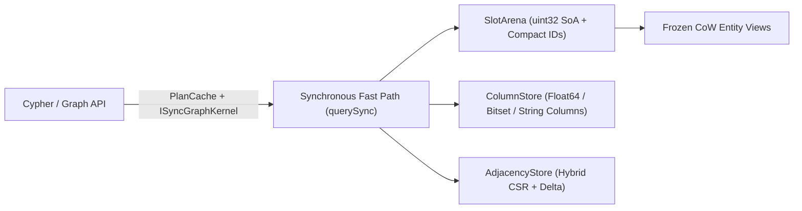

With Grafio `v8.0.0`, we rebuilt the in-memory storage and Cypher execution engine from the ground up around a pure-TypeScript (`es2020` TypedArrays, zero native addons, identical in Node.js and `@grafio/browser`) **Structure-of-Arrays (SoA)** and **Hybrid Global CSR + Delta** architecture.

Compared to our earlier [`v7` benchmarks](/blog/grafio-in-memory-performance-benchmarks) on `v7.15.1`, at **100,000 nodes and 300,142 edges**, Grafio 8 delivers:

- **4.8x faster graph builds** (`3,227 ms` → `671 ms`), **31.5% smaller heap** (`133.9 MB`), and **73.1% smaller RSS** (`+421.7 MB`)
- **~39,667x faster label scans** (`119 ms` → `0.003 ms`, **299.2K ops/sec**)
- **149x faster unindexed property scans** (`660 ms` → `4.43 ms`)
- **77.6x faster variable-length traversals (1..5)** (`9.08 ms` → `0.117 ms`, **8.5K ops/sec**)
- **57x faster endpoint edge lookups** (`0.285 ms` → `0.005 ms`, **219.0K ops/sec**)
- **18.4x faster multi-join aggregations** (`343 ms` → `18.61 ms`)

<!-- truncate -->

## What Changed Between Grafio 7 and Grafio 8

In `v7.x`, `InMemoryStorageProvider` stored object graphs in nested `Map`s, generated random UUIDs for every entity, deeply cloned objects (`structuredClone`) on every read to preserve immutability, wrapped in-memory graphs with `CachedStorageProvider` serialization overhead, and pushed every Cypher operator through async `Promise` ticks.

Grafio `v8.0.0` eliminates those bottlenecks in five layers while preserving zero native dependencies:



1. **Dense `uint32` SoA `SlotArena` & Compact Generational IDs:** Nodes and edges map to contiguous `uint32` slots with hash-free `@n<slot>:<gen>` and `@e<slot>:<gen>` IDs by default (no per-insert CSPRNG UUID cost; `idStrategy: 'uuid'` remains opt-in), freeing GC pressure and pointer chasing.
2. **Tag-Encoded Adaptive `ColumnStore`:** Homogeneous numeric properties sit in cache-local `Float64Array` columns (`Uint8Array` bit-packed booleans and dense string arrays for booleans/strings, promoting seamlessly to `mixed`), with lazy Copy-on-Write (`Object.freeze`) wrappers materialized only when a caller actually inspects `.properties` or `.labels`.
3. **Hybrid Global CSR + Delta `AdjacencyStore`:** Bulk inserts and `graph.compact()` pack adjacency lists into flat Compressed Sparse Row (`Uint32Array`) arrays, while incremental edge writes land in compact per-node delta buffers without rebuilding CSR on every mutation.
4. **Synchronous Kernel (`ISyncGraphKernel`) & Fused Cypher Pipelines:** `CypherEngine` compiles expressions with a CSP-safe `ClosureCompiler` (`SlotRow` array registers instead of per-row `Record` allocations), caches plans by `indexEpoch`, traverses via `Uint32RingQueue` BFS, and executes fused `NodeScan -> Filter -> Aggregate` queries synchronously without `Promise` microtasks.
5. **Direct In-Memory Binding:** `InMemoryGraphFactory` now binds directly to `InMemoryStorageProvider` instead of double-caching already in-memory data through `CachedStorageProvider`.

## Test Environment

Both Grafio `v7.15.1` and `v8.0.0` were measured back-to-back on the exact same machine and `--expose-gc` benchmark harness (`npm run perf:gc` running `tests/perf/entryPoint.ts`):

| Component | Details |
|-----------|---------|
| **CPU** | Intel Core Ultra 9 185H (16 Cores / 22 Threads) |
| **RAM** | 32 GB DDR5 |
| **Storage** | NVMe SSD |
| **Node.js** | v24.15.0 with `--expose-gc` |
| **Graph Scales** | Small (`10,000` nodes / `30,020` edges), Medium (`50,000` nodes / `150,014` edges), Large (`100,000` nodes / `300,142` edges) |

## Graph Build & Memory Footprint (`v7.15.1` vs `v8.0.0`)

Because typed SoA columns and CSR offsets store raw values instead of per-entity hash maps and UUID strings, Grafio 8 cuts cold graph construction time by **up to 4.8x** while cutting resident memory (RSS) by **57%–73%**:

| Scale | Metric | `v7.15.1` | `v8.0.0` | Improvement |
|-------|--------|----------:|---------:|-------------|
| **Small** (10K / 30,020 edges) | Build Time | `212 ms` | `70 ms` | **3.0x faster** |
| **Small** (10K / 30,020 edges) | Heap Footprint | `+20.3 MB` | `+12.7 MB` | **37.4% smaller** |
| **Small** (10K / 30,020 edges) | RSS | `+342.8 MB` | `+141.8 MB` | **58.6% smaller** |
| **Medium** (50K / 150,014 edges) | Build Time | `712 ms` | `411 ms` | **1.7x faster** |
| **Medium** (50K / 150,014 edges) | Heap Footprint | `+97.7 MB` | `+66.8 MB` | **31.6% smaller** |
| **Medium** (50K / 150,014 edges) | RSS | `+636.2 MB` | `+273.3 MB` | **57.0% smaller** |
| **Large** (100K / 300,142 edges) | Build Time | `3,227 ms` | `671 ms` | **4.8x faster** |
| **Large** (100K / 300,142 edges) | Heap Footprint | `+195.4 MB` | `+133.9 MB` | **31.5% smaller** |
| **Large** (100K / 300,142 edges) | RSS | `+1,568.8 MB` | `+421.7 MB` | **73.1% smaller** |

## Large Scale Head-to-Head (`100,000` nodes / `300,142` edges)

Every single benchmark scenario on `100K` nodes improved between **7x and ~39,667x**:

| Category | Operation | `v7.15.1` Mean | `v8.0.0` Mean | `v7.15.1` ops/sec | `v8.0.0` ops/sec | Speedup |
|----------|-----------|---------------:|--------------:|------------------:|-----------------:|---------|
| **Write** | Graph Construction | `1.38 ms` | `0.161 ms` | `726` | `6.2K` | **8.6x** |
| **Write** | `addNode` (single) | `0.017 ms` | `0.002 ms` | `60.5K` | `567.1K` | **8.5x** |
| **Write** | `addEdge` (single) | `0.014 ms` | `0.002 ms` | `70.3K` | `420.5K` | **7.0x** |
| **Read** | Get Node by id (parameterised) | `0.101 ms` | `0.003 ms` | `9.9K` | `342.0K` | **33.7x** |
| **Read** | Get nodes by id | `0.138 ms` | `0.004 ms` | `7.2K` | `240.2K` | **34.5x** |
| **Read** | Get nodes by type | `119 ms` | `0.003 ms` | `8` | `299.2K` | **~39,667x** |
| **Read** | Get nodes by property | `660 ms` | `4.43 ms` | `2` | `226` | **149.0x** |
| **Read** | Get all Nodes | `0.085 ms` | `0.004 ms` | `11.8K` | `261.4K` | **21.3x** |
| **Navigation** | Get Edges from node by id | `0.269 ms` | `0.009 ms` | `3.7K` | `105.5K` | **29.9x** |
| **Navigation** | Get Edges to node by id | `0.319 ms` | `0.006 ms` | `3.1K` | `157.0K` | **53.2x** |
| **Navigation** | Get edges between nodes by ids | `0.285 ms` | `0.005 ms` | `3.5K` | `219.0K` | **57.0x** |
| **Traversal** | Traversal var-length (`1..5`) | `9.08 ms` | `0.117 ms` | `110` | `8.5K` | **77.6x** |
| **Traversal** | Traversal with types | `2.62 ms` | `0.039 ms` | `381` | `25.9K` | **67.2x** |
| **Traversal** | Traversal wildcard with types | `0.437 ms` | `0.010 ms` | `2.3K` | `104.2K` | **43.7x** |
| **Aggregation** | Aggregate score/amount by type | `29.14 ms` | `1.80 ms` | `34` | `555` | **16.2x** |
| **Aggregation** | Aggregate across two joins | `343 ms` | `18.61 ms` | `3` | `54` | **18.4x** |

## Scaling Across 10K, 50K, and 100K Graphs

Even at Small (`10K`) and Medium (`50K`) scales, eliminating defensive `structuredClone` allocations and Promise microtasks shifts single-node/edge writes up to **618.8K ops/sec** (`addNode` @ 50K) and brings multi-hop traversals and type scans down to tens of microseconds:

| Operation | Small 10K (`v7` → `v8`) | Medium 50K (`v7` → `v8`) | Large 100K (`v7` → `v8`) |
|-----------|-------------------------|--------------------------|--------------------------|
| Graph Construction | `1.60 ms` → `0.450 ms` | `0.702 ms` → `0.195 ms` | `1.38 ms` → `0.161 ms` |
| `addNode` (single) | `0.018 ms` → `0.003 ms` | `0.014 ms` → `0.002 ms` | `0.017 ms` → `0.002 ms` |
| `addEdge` (single) | `0.016 ms` → `0.003 ms` | `0.013 ms` → `0.002 ms` | `0.014 ms` → `0.002 ms` |
| Get Node by id (parameterised) | `0.073 ms` → `0.004 ms` | `0.065 ms` → `0.003 ms` | `0.101 ms` → `0.003 ms` |
| Get nodes by id | `0.089 ms` → `0.003 ms` | `0.084 ms` → `0.003 ms` | `0.138 ms` → `0.004 ms` |
| Get nodes by type | `8.79 ms` → `0.004 ms` | `25.57 ms` → `0.003 ms` | `119 ms` → `0.003 ms` |
| Get nodes by property | `35.50 ms` → `0.540 ms` | `119 ms` → `2.45 ms` | `660 ms` → `4.43 ms` |
| Get all Nodes | `0.113 ms` → `0.005 ms` | `0.089 ms` → `0.004 ms` | `0.085 ms` → `0.004 ms` |
| Get Edges from node by id | `0.087 ms` → `0.008 ms` | `0.253 ms` → `0.005 ms` | `0.269 ms` → `0.009 ms` |
| Get Edges to node by id | `0.135 ms` → `0.005 ms` | `0.270 ms` → `0.006 ms` | `0.319 ms` → `0.006 ms` |
| Get edges between nodes by ids | `0.115 ms` → `0.007 ms` | `0.296 ms` → `0.008 ms` | `0.285 ms` → `0.005 ms` |
| Traversal var-length (`1..5`) | `3.45 ms` → `0.218 ms` | `8.47 ms` → `0.147 ms` | `9.08 ms` → `0.117 ms` |
| Traversal with types | `0.238 ms` → `0.011 ms` | `0.439 ms` → `0.015 ms` | `2.62 ms` → `0.039 ms` |
| Traversal wildcard with types | `0.264 ms` → `0.025 ms` | `0.639 ms` → `0.020 ms` | `0.437 ms` → `0.010 ms` |
| Aggregate score/amount by type | `1.05 ms` → `0.483 ms` | `6.07 ms` → `1.02 ms` | `29.14 ms` → `1.80 ms` |
| Aggregate across two joins | `11.80 ms` → `0.981 ms` | `145 ms` → `5.72 ms` | `343 ms` → `18.61 ms` |

## Performance Visualization

import PerformanceChartsV8 from '@site/src/components/PerformanceChartsV8';

<PerformanceChartsV8 />

## Getting Maximum Speed in Grafio 8

```typescript
import { Graph } from 'grafio';

const graph = new Graph();

// 1. Batch-insert initial datasets to build CSR buffers in one pass
await graph.addNodes(nodes);
await graph.addEdges(edges);

// 2. Compact after heavy incremental writes/deletes
graph.compact();

// 3. Opt in to scoped indexes for selective property predicates
await graph.query(`CREATE INDEX idx_person_age FOR (n:Person) ON (n.age)`);

// 4. Use parameterised querySync() for zero-microtask in-memory reads
const res = graph.querySync(
  'MATCH (p:Person) WHERE p.age >= $min RETURN p.name AS name',
  { min: 30 },
);
```

## Next Steps

- Run `npm run perf:gc` locally or customize scenarios using the [Performance Testing Guide](/docs/examples/performance).
- Review the [`v8.0.0` Changelog](https://github.com/satya-jugran/grafio/blob/main/CHANGELOG.md) for breaking changes and architectural contracts.
- Try Cypher execution and 3D graph visualization live in your browser on the [Grafio Playground](/playground).
