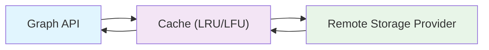

# Caching

Improve read performance for remote or async storage providers with Grafio's pluggable caching layer.

> **In-Memory Note:** `InMemoryGraphFactory` and `new Graph()` bind directly to `InMemoryStorageProvider`, whose Structure-of-Arrays (SoA) and Hybrid CSR storage already executes synchronously in memory without `CachedStorageProvider` wrapping.

## Overview



## Quick Start

```typescript
import {
  Graph,
  GraphManager,
  CachedStorageProvider,
  type CacheConfig,
} from 'grafio';

const cacheConfig: CacheConfig = {
  maxNodesCount: 1000,
  maxEdgesCount: 2000,
  cacheStore: 'in-memory',
  evictionStrategy: 'LRU',
  preloadStrategy: 'none',
};

// 1. Initialize GraphManager with cache config
GraphManager.init({ cache: cacheConfig });
const cacheManager = GraphManager.getInstance().getCacheManager()!;

// 2. Wrap a remote/async storage provider (e.g., MongoStorageProvider from grafio-mongo)
const cachedProvider = new CachedStorageProvider(
  remoteProvider,
  'default',
  cacheManager,
  cacheConfig,
);
const graph = new Graph(cachedProvider);
```

## Cache Configuration

### CacheConfig Options

| Option | Type | Default | Description |
|--------|------|---------|-------------|
| `maxNodesCount` | number | 1000 | Max nodes to cache |
| `maxEdgesCount` | number | 2000 | Max edges to cache |
| `cacheStore` | `'in-memory'` \| `'redis'` | `'in-memory'` | Cache backend |
| `evictionStrategy` | `'LRU'` \| `'LFU'` \| `'FIFO'` | `'LRU'` | Eviction algorithm |
| `preloadStrategy` | `'none'` \| `'all'` \| `'first-n'` | `'none'` | Preload strategy |
| `ttlSeconds` | number | 3600 | Redis TTL (if using Redis) |

### Eviction Strategies

| Strategy | Description |
|----------|-------------|
| `LRU` | Least Recently Used |
| `LFU` | Least Frequently Used |
| `FIFO` | First In, First Out |

### Preload Strategies

| Strategy | Description |
|----------|-------------|
| `'none'` | No preload (default) |
| `'all'` | Preload all nodes and edges |
| `'first-n'` | Preload first N items |

## Using Redis Cache

```typescript
import { GraphManager } from 'grafio';
import { RedisCache } from 'grafio/cache';

GraphManager.init({
  cache: {
    cacheStore: 'redis',
    redisUrl: 'redis://localhost:6379',
    maxNodesCount: 5000,
    maxEdgesCount: 10000,
    evictionStrategy: 'LRU',
    preloadStrategy: 'all',
    ttlSeconds: 7200,
  }
});
```

## Cache Statistics

Monitor cache performance via `CacheManager.getStats()`:

```typescript
const cacheManager = GraphManager.getInstance().getCacheManager()!;
const stats = cacheManager.getStats();
console.log(`Hits: ${stats.hitCount}, Misses: ${stats.missCount}`);
console.log(`Hit rate: ${(stats.hitRate * 100).toFixed(2)}%`);
console.log(`Nodes: ${stats.totalNodes}, Edges: ${stats.totalEdges}`);
```

## Performance Tips

1. **Set appropriate limits** — don't cache more than you need
2. **Use preload** — if startup time isn't critical, call `await graph.warmCache()`
3. **Choose right eviction** — LRU for temporal patterns, LFU for frequency
4. **Monitor hit rate** — aim for >80% hit rate

## Next Steps

- [Storage Providers](./storage-providers) — pluggable backends
- [API Reference](../api-reference/graph-manager) — GraphManager API
- [API Reference](../api-reference/cache-manager) — CacheManager API
